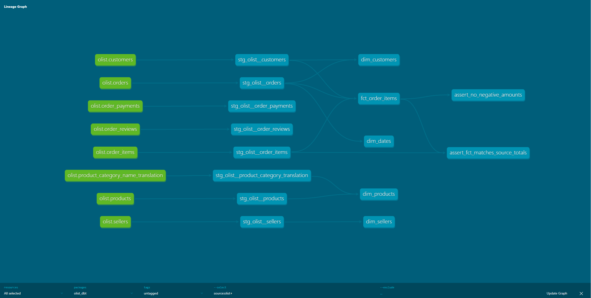

# 🧱 Modelo estrella con dbt — Olist E-Commerce



## Problema
Los datos operativos de Olist vienen en 8 tablas pensadas para registrar pedidos, no para analizarlos. Este proyecto las transforma con dbt en un **modelo estrella** (una tabla de hechos y cuatro dimensiones), con tests de calidad y documentación generada automáticamente, para que las preguntas de negocio se respondan con consultas simples.

## Datos
- Fuente: [Brazilian E-Commerce Public Dataset by Olist (Kaggle)](https://www.kaggle.com/datasets/olistbr/brazilian-ecommerce), cargado en PostgreSQL con el proyecto [sql-analytics-olist](https://github.com/ElYaret/sql-analytics-olist).
- Los datos no se incluyen en este repositorio.

## Modelos
```
fuentes (8 tablas)  ─►  staging (8 vistas)  ─►  marts (1 hecho + 4 dimensiones)
```

| Modelo | Capa | Descripción |
|---|---|---|
| `stg_olist__*` (8) | staging | Una vista por tabla original: nombres consistentes, sin lógica de negocio. Corrige los typos del dataset (`lenght`). |
| `fct_order_items` | marts | Tabla de hechos. Una fila por ítem de pedido (112,650). |
| `dim_customers` | marts | Una fila por **persona** (96,096), con los datos de su compra más reciente. |
| `dim_products` | marts | Una fila por producto (32,951), con la categoría en inglés cuando existe traducción. |
| `dim_sellers` | marts | Una fila por vendedor (3,095). |
| `dim_dates` | marts | Una fila por día (774), generada desde la primera hasta la última compra. |

## Decisiones de diseño
- **Granularidad del hecho:** el ítem de pedido, el nivel más detallado en el que hay precio y flete.
- **`dim_customers` por `customer_unique_id`:** en Olist cada pedido genera un `customer_id` nuevo, así que agrupar por él cuenta pedidos y no personas.
- **Llave artificial `order_item_key`** (`order_id` más el número de ítem), porque el hecho no tiene una llave simple.
- **`dim_dates` generada con SQL** (`generate_series`), sin depender de un archivo externo.
- **Staging como vistas y marts como tablas:** la limpieza no ocupa espacio, y el modelo que se consulta está calculado de antemano.
- **Sin secretos en el repositorio:** `profiles.yml` lee la conexión de variables de entorno; la contraseña vive en `.env`, que está fuera de Git.

## Calidad de datos
34 tests (32 genéricos y 2 propios) que corren con `dbt build`:
- `unique` y `not_null` en las llaves de cada modelo.
- `relationships`: cada cliente, producto, vendedor y fecha del hecho existe en su dimensión.
- `accepted_values` para el estado del pedido.
- Tests propios: el total de precios del hecho coincide con el de staging, y no hay precios ni fletes negativos.
- **Un aviso intencional:** el test de unicidad de `review_id` está en `severity: warn`, porque Olist repite 789 `review_id` en distintos pedidos. Es un problema del dato original, no del modelo.

El modelo reproduce los ingresos mensuales calculados a mano en el proyecto de SQL (por ejemplo, noviembre de 2017: 1,003,862.14 sin pedidos cancelados).

Resultado esperado de `dbt build`: `PASS=46 WARN=1 ERROR=0`.

## Documentación
```powershell
dbt docs generate --profiles-dir .
dbt docs serve --profiles-dir .
```
Se abre en `http://localhost:8080`, con las columnas, los tests y el grafo de linaje de cada modelo.

## Tecnologías usadas
dbt Core, dbt-postgres, PostgreSQL, SQL

## Cómo ejecutarlo
Requisito: una base `olist_ecommerce` en PostgreSQL local, con las tablas de Olist en el esquema `public`.

```powershell
git clone https://github.com/ElYaret/olist-dbt.git
cd olist-dbt
py -m venv venv
venv\Scripts\activate
pip install -r requirements.txt
Copy-Item .env.example .env
```
Edita `.env` con los datos de tu PostgreSQL local. Luego carga las variables en la sesión y ejecuta:

```powershell
Get-Content .env | ForEach-Object { $k, $v = $_ -split '=', 2; Set-Item "env:$k" $v }
dbt build --profiles-dir .
```
Los modelos se crean en los esquemas `analytics_staging` y `analytics_marts`.

## Limitaciones
- Solo se modela `order_items`: los pagos y las reseñas están en staging, pero todavía no tienen tabla de hechos.
- No se usa la tabla de geolocalización.
- `dim_dates` no incluye feriados.
- No hay integración continua, porque los datos de Olist no están en el repositorio.

## Próximos pasos
- Tablas de hechos para pagos y reseñas.
- Integración continua que valide la compilación del proyecto.
